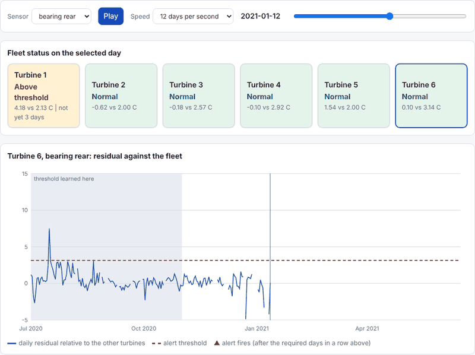
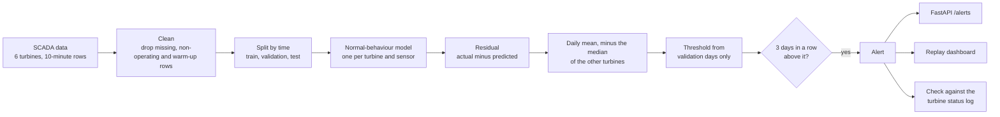
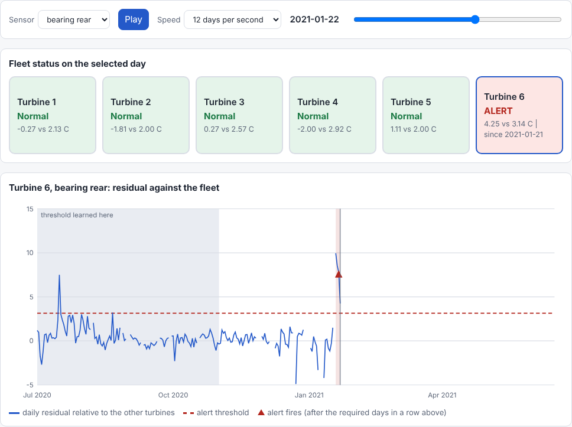

# Early-warning for wind turbine components from SCADA data


 Live demo (a replay of stored data, not live data): [Open the dashboard](https://illayacodes.github.io/turbine-early-warning/dashboard.html)

(https://illayacodes.github.io/turbine-early-warning/dashboard.html)

A normal-behaviour pipeline on open wind farm data. It learns how warm a turbine component normally runs for a given wind, power and ambient temperature. When the real temperature stays above the prediction for several days in a row, it raises an alert. Alerts are then checked against the turbine's own status log.



*The replay dashboard on the real test data. Turbine 6, rear generator bearing: the alert fires on 21 Jan 2021, 15 days before the logged drivetrain stop on 5 Feb. The turbine's own heating warning came a day earlier, so read [the one hit](#the-one-hit-and-what-it-does-not-show) before drawing conclusions.*

[Dashboard](#dashboard) · [Results](#results) · [The one hit](#the-one-hit-and-what-it-does-not-show) · [Weaknesses](#weaknesses) · [Run it](#run-it) · [API](#api)

> [!IMPORTANT]
> This is a learning project. In the data I used there is exactly one logged drivetrain stop, so the detection result is a single case study and not a statistic. Please read the [Weaknesses](#weaknesses) section before the Results.

## At a glance

| | |
|---|---|
| Data | Kelmarsh wind farm (UK), 6 Senvion MM92 turbines, 10-minute SCADA and status logs |
| What is monitored | 3 temperatures per turbine: gear oil, front and rear generator bearing |
| Models compared | Training average, linear regression, gradient boosting |
| Test block | 1 Nov 2020 to 1 Jul 2021 (about 8 months, split by time, never at random) |
| Alerts (linear model) | 13 alerts, 11 episodes |
| Detections | 1 alert within 30 days before the one logged drivetrain stop (15 days ahead) |
| Unmatched episodes | 0.21 per turbine-month (linear), unlabelled and not confirmed as false alarms |
| Prediction error | 1.99 to 2.77 °C (linear), 1.78 to 2.57 °C (boosting), against 3.04 to 4.17 °C for the training average |
| Also included | FastAPI service, Docker image, replay dashboard, 61 pytest tests |

## Why not a classifier

Real component failures are rare. A supervised "fault / no fault" classifier would have almost nothing to learn from here. Normal operation is plentiful, so the pipeline models normal behaviour and looks for sustained departures from it.

## How it works



## Dashboard



`docs/dashboard.html` is a single page that opens in any browser with no server and no internet. It replays the saved test period one day at a time:

- a status card per turbine (normal, above threshold, alert) for the chosen sensor, with a note when the same turbine is in alert on another sensor,
- the daily residual against the alert threshold, with the validation period shaded as "threshold learned here",
- a log of the alerts that had fired by the selected day, and the logged stop once the replay reaches it.

Press Play, drag the slider, pick a sensor, or click a turbine card or a log entry. Thresholds and alerts come from the same function that was scored, so the dashboard cannot disagree with the results below.

It is a **replay of stored history, not a live monitor**. Live use would need a daily feed of the same signals, which is not built.

    python build_dashboard.py          # recompute from the data (takes minutes), writes docs/dashboard.html
    python build_dashboard.py reuse    # rebuild the page from docs/dashboard-data.json (takes seconds)

## Data

Kelmarsh wind farm, UK: six Senvion MM92 turbines, 10-minute SCADA data and status logs, 2016 to mid-2021, released by Cubico Sustainable Investments Ltd.

Source: Zenodo record 5841834, version 0.0.3, https://doi.org/10.5281/zenodo.5841834
Licence: CC-BY-4.0 (attribution required). The data is not stored in this repository.

Citation: Plumley, C. (2022). Kelmarsh wind farm data (Version 0.0.3) [Data set]. Zenodo. https://doi.org/10.5281/zenodo.5841834

<details>
<summary>Things I found while auditing the files</summary>

- All temperature and speed signals are empty from January to April 2016, so usable temperature data starts in May 2016.
- Missing values are written as NaN. Some months have gaps (for example October 2018, when all six turbines were stopped by a site-wide grid event).
- The status logs record events, not component diagnoses. There is no failure logbook, so I had to decide what counts as a fault from stop codes and messages.

</details>

## Method

**Cleaning** (`src/turbine_ew/preprocess.py`, thresholds in `configs/config.yaml`):
- Drop rows with missing values, never fill them.
- Drop physically implausible rows (for example rotor speed above 20 RPM).
- Keep only rows where the turbine is producing power in its normal wind range (3 to 25 m/s).
- Drop the 6 hours after any stop of 2 hours or more, while components are still warming up.

**Normal-behaviour models** (`src/turbine_ew/models.py`): one model per turbine and per sensor. Inputs are wind speed, power, rotor speed, gearbox speed and nacelle ambient temperature. Targets are gear oil temperature and the front and rear generator bearing temperatures. Three models are compared: always predict the training average, linear regression, and gradient boosting (scikit-learn `HistGradientBoostingRegressor`, early stopping off so it makes no hidden random split).

**Time-based split, never random** (`src/turbine_ew/split.py`, tested for ordering and overlap). Event period:

| Block | Dates | Used for |
|---|---|---|
| Train | 1 Jul 2019 to 30 Jun 2020 (12 months, a full seasonal cycle) | fitting the models |
| Validation | 1 Jul to 31 Oct 2020 | setting alert thresholds only |
| Test | 1 Nov 2020 to 1 Jul 2021 | scoring |

**Alert rule** (`src/turbine_ew/alerts.py`):
1. Residual = actual minus predicted temperature, averaged per day (days with fewer than 36 clean rows are ignored).
2. Fleet-relative residual = the turbine's daily residual minus the median of the other turbines on the same day (at least 3 others needed). This cancels weather and site-wide effects.
3. Threshold per turbine and sensor = max(4 times the robust spread, 2.0 °C), where the spread is 1.4826 times the median absolute deviation over the validation days.
4. An alert fires on the third consecutive day above the threshold.
5. A hit means an alert within the 30 days before a logged drivetrain stop on the same turbine. Anything else is called unmatched. Unmatched does not mean false: most alerts have no label either way.
6. Reporting only: alerts on the same turbine and sensor less than 8 days apart are merged into one episode.

The rule parameters (4, 2.0, 3 days, 36 rows, 30 days) were fixed before I counted alerts. They were not tuned on the test block. Two caveats: I had already looked at the January 2021 daily residuals on turbine 6 before writing the rule, and the 7-day merge for episodes was chosen after I had seen the alerts. So both raw alert counts and episode counts are reported.

## Results

**Prediction error**, mean over 6 turbines, event period test block (mean absolute error in °C, lower is better):

| Sensor | Training average | Linear | Boosting |
|---|---|---|---|
| Gear oil | 3.04 | 2.18 | 1.78 |
| Front generator bearing | 4.17 | 2.77 | 2.57 |
| Rear generator bearing | 3.19 | 1.99 | 1.94 |

Error grows from the validation block to the test block (for boosting: 1.40 to 1.78, 2.34 to 2.57, 1.48 to 1.94). The full table is in `docs/errors_event_period.csv`.

**Alerts**, event period test block (1 Nov 2020 to 1 Jul 2021, about 8 months, 6 turbines, 3 sensors each):

| Model | Alerts | Episodes | Hits | Unmatched episodes | Per turbine-month |
|---|---|---|---|---|---|
| Linear | 13 | 11 | 1 | 10 | 0.21 |
| Boosting | 19 | 12 | 1 | 11 | 0.23 |

The raw unmatched alert rate is 0.25 (linear) and 0.38 (boosting) per turbine-month. Every alert is on a generator bearing, none on gear oil. Most unmatched alerts fall in winter. Ten of the 18 boosting thresholds sit at the 2.0 °C floor.

**Second period with no labelled fault** (train Jul 2017 to Jun 2018, validate Jul to Oct 2018, test 1 Nov 2018 to 31 Dec 2019, about 14 months): both models gave 15 alerts and 12 episodes, 0.14 per turbine-month. Ten of the 12 episodes begin in November or December. This period can only show how often the rule fires, since it contains no labelled event.

Linear regression did as well as gradient boosting under this alert rule, even though boosting predicts temperatures more accurately.

## The one hit, and what it does not show

Turbine 6 had a drivetrain stop on 5 Feb 2021 (code 1055, Max. drivetrain oscillations, 77 hours), followed by about 25 days of manual service stop. The rear generator bearing alert fired on 21 Jan 2021, 15 days earlier. The daily residual was already about 8 °C above the other turbines on 18 to 21 Jan.

Reasons for caution:
- The turbine logged its own "Overload generator heating" warning on 20 Jan, one day before the alert. In all 8 cases where an alert had a thermal log message nearby, the message came 0 to 3 days before the alert date. The system did not beat the turbine's own alarms.
- Technicians visited on 18, 20 and 21 Jan and the temperatures returned to normal by 25 Jan. The episode may have been a cooling problem that was fixed, and not an early sign of the 5 Feb vibration stop. The log does not say. Nothing links the two events except timing.
- Where an alert had a thermal message nearby, a comparison with a chance baseline gave 6 against about 0.6 expected in the second period (not just chance), and 2 against about 1.5 expected in the event period (not distinguishable from chance).

<details>
<summary>Other findings</summary>

- Turbine 6 had a 110-hour frequency converter error in Nov 2017. None of the five temperatures I checked showed a warning before it. A converter fault is electrical, so this may be expected, and weekly averages could hide a short precursor.
- Turbine 5's rear bearing ran about 2 °C above the fleet from Jan to May 2021 and returned to normal in June. That produced 4 to 5 of the unmatched episodes. The cause is unknown (cooling, sensor offset or recalibration would all look like this).
- I found no gearbox or generator-bearing failure in the status logs I searched for 2016 to 2021 (keyword search on stops plus a listing of all stops longer than 24 hours). Most long stops were grid events, icing, converter errors or planned service.

</details>

## Weaknesses

> [!WARNING]
> These limits decide how far the results can be trusted.

- One labelled drivetrain stop. This is a case study, and I cannot give a hit rate or a reliable false alarm rate.
- The alert was not earlier than the turbine's own thermal warning, and the link to the stop is unproven.
- Thresholds come from a validation window (Jul to Oct) with no winter, so winter alerts are likely too frequent. I did not fix this on the test data.
- Unmatched alerts are unlabelled and may be real, sensor offsets, or model drift. I cannot tell which.
- The models age. Errors grow after the training year, so a real system would retrain on a schedule. I did not implement that.
- The fleet-relative signal cannot detect a fault that affects all turbines at once.
- The 7-day episode merge and the warm-up settings were chosen after looking at related data, as described above.
- The API serves the alerts saved by the training run. It does not compute live fleet-relative alerts from new data, and it has no authentication.

## Run it

Python 3.14 was used. Create an environment and install:

    python -m venv .venv
    .venv\Scripts\Activate.ps1
    pip install -r requirements.txt

To look at the dashboard you need nothing else: open `docs/dashboard.html` in a browser.

To rerun the pipeline, download the data from Zenodo record 5841834 (files `Kelmarsh_SCADA_2019_3085.zip`, `Kelmarsh_SCADA_2020_3086.zip` and `Kelmarsh_SCADA_2021_3087.zip` for the event period, plus the 2016 to 2018 zips for the second period) and unzip each into `data/raw/kelmarsh2019`, `data/raw/kelmarsh2020` and so on.

Run the tests (61 pass), train and serve:

    python -m pytest -q
    python train.py
    python -m uvicorn src.turbine_ew.main:app --port 8000

`train.py` writes `models/models.joblib`, `models/thresholds.csv` and `models/alerts.csv`. The `models` folder is not in Git because it is generated.

Docker (built and health-checked with Docker Desktop 29.7.2 on Windows; run `train.py` first so the `models` folder exists):

    docker build -t turbine-early-warning .
    docker run --rm -p 8000:8000 turbine-early-warning

## API

Interactive documentation is at http://localhost:8000/docs once the server is running.

| Endpoint | What it does |
|---|---|
| `GET /health` | Model name, turbines and targets. |
| `POST /predict` | One 10-minute reading in, expected temperatures out. If actual temperatures are included, it also returns the residual (actual minus expected, positive means hotter than expected), but only for readings in the operating range. One residual is not an alert. |
| `GET /alerts` | Saved alerts with their thresholds, filtered by turbine, target, since and until. |

Example request body for `POST /predict` (made-up values, to show the fields):

```json
{
  "turbine": 1,
  "wind_speed": 8.0,
  "power": 900.0,
  "rotor_speed": 13.0,
  "gearbox_speed": 1300.0,
  "ambient_temp": 10.0
}
```

Illustration only: a row from turbine 6 at 12:00 on 19 Jan 2021, picked from inside the episode described above. Actual 52.3, 33.4 and 56.0 °C against expected 51.8, 32.7 and 45.0, so the residuals are +0.5, +0.7 and +11.0. It shows how the endpoint works and is not a result.

## Repository map

```text
configs/config.yaml        every setting: signals, cleaning, splits, alert rule, serving
src/turbine_ew/            data loading, cleaning, split, models, alerts, pipeline,
                           training, serving, the API and the dashboard
tests/                     61 pytest tests: cleaning, time split, models, alerts,
                           episodes, training artifacts, API, dashboard
docs/                      dashboard.html, dashboard-data.json, saved alerts and
                           error tables, run logs, drift plots, img/ (README images)
build_dashboard.py         builds docs/dashboard.html
train.py                   trains the models and saves the artifacts
check_*.py, run_*.py,      exploration and evaluation scripts behind the numbers above
report_errors.py           (their outputs are in docs)
Dockerfile                 serving image; requirements.txt is the full freeze,
requirements-serve.txt     requirements-serve.txt is what the server needs
```

## What I would do next

- Add more labelled faults: Penmanshiel (14 turbines, same format) and EDP's failure logbook (I have not confirmed its licence terms).
- Set thresholds on a validation window that includes winter, then score on fresh data without touching the rule.
- Retrain on a schedule and measure how quickly the models age.
- Compute the fleet-relative alerts live in the API.
- Report confidence intervals, and test how sensitive the results are to the warm-up and threshold settings.

## Acknowledgements

Thanks to Cubico Sustainable Investments Ltd and Charlie Plumley for releasing the data under CC-BY-4.0. The author's request, that users tell them how the data is used, is on the Zenodo record.
